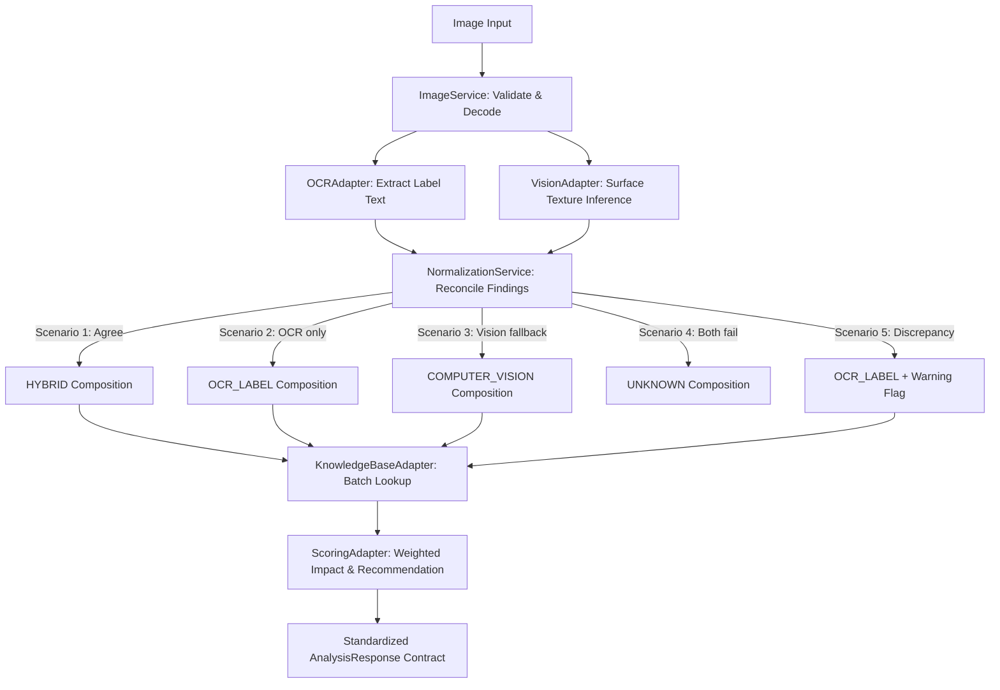

# GreenWardrobe: Team Module Integration Guide

This guide documents the architecture, data contracts, provenance, and verification of all teammate modules integrated into the unified GreenWardrobe FastAPI backend.

---

## 1. Team Module Inventory & Verification Status

| Module | Owner / Contributor | Integration Status | Inference / Execution Status | Data Provenance & Notes |
| :--- | :--- | :--- | :--- | :--- |
| **01. Scoring & Decision Engine** | Maneesh Kumar (`origin/Scoring-&-Decision-Engine`) | **`REAL INTEGRATION VERIFIED`** | **`OPERATIONAL`** | Rule-based engine with 6 impact categories (`water`, `carbon`, `energy`, `chemicals`, `microfibres`, `waste`). 15 materials supported. Values are explicit `DEMO PLACEHOLDER` benchmarks. |
| **02. Clothing Care Label OCR** | Harshit Upadhyay (`origin/feature/-clothing-label-ocr`) | **`REAL INFERENCE VERIFIED`** | **`OPERATIONAL`** | EasyOCR + OpenCV CLAHE pipeline. Live inference verified on real label fixtures (`label_0001.jpg` – `label_0005.jpg`). |
| **03. Computer Vision Fabric Classifier** | Anshika Thakur (`origin/feature/computer-vision`) | **`REAL INFERENCE VERIFIED`** | **`OPERATIONAL`** | Official TextileNet ResNet-18 baseline checkpoint (`res18_ckpt.pth`) loaded. 33 classes mapped. Live tensor forward pass & predictions verified. Excluded from git via `.gitignore`. |
| **04. Material Knowledge Base** | Ankit Yadav (role) / Backend Team (author) | **`OPERATIONAL (BACKEND REPLACEMENT)`** | **`OPERATIONAL`** | 33 TextileNet classes profiled with transparent LCA literature citations (EEA, UNEP, Higg MSI, Textile Exchange). Upstream assets were uncommitted (`computer-vision/data/` was in `.gitignore`); authored as a backend replacement without false attribution. |
| **05. Frontend Web Application** | Lakshya Nailwal (`origin/feature/frontend`) | **`EXTERNAL CLIENT`** | **`STANDALONE`** | React + Tailwind client running on `http://localhost:5173`. Consumes backend contracts. |

---

## 2. Deep Module Architecture & Provenance

### A. Computer Vision Module (Anshika Thakur)
- **Source Location in Backend:** `app/integrations/teammate_modules/vision/`
- **Adapter:** `app/integrations/vision_adapter.py` (`VisionAdapter`)
- **Model Architecture:** ResNet-18 (TextileNet implementation)
- **Checkpoint Checksum & Metadata:**
  - **Filename:** `res18_ckpt.pth`
  - **Source URL:** `https://raw.githubusercontent.com/hahashu/TextileNet/main/baselines/TextileNet-fibre/res18_ckpt.pth`
  - **Official Citation:** Shu Zhong et al., *"TextileNet: A Material Taxonomy-based Fashion Textile Dataset"*, arXiv:2301.06160 (2023).
  - **File Size:** 44,853,197 bytes (~42.8 MB)
  - **SHA-256:** `2fd22d887fa43de3f9efbe5e3bb3cbe8d1058d1e70c0eb233caf7f25922ff34b`
  - **Training Checkpoint Metadata:** Epoch 38, Top-1 Validation Accuracy: 49.697% (matches Anshika's documented baseline).
- **Label Taxonomy:** 33 fibre classes ordered 0 to 32 (`abaca`, `acrylic`, `alpaca`, `angora`, `aramid`, `camel`, `cashmere`, `cotton`, `cupro`, `elastane_spandex`, `flax_linen`, `fur`, `hemp`, `horse_hair`, `jute`, `leather`, `llama`, `lyocell`, `milk_fibre`, `modal`, `mohair`, `nylon`, `polyester`, `polyolefin`, `ramie`, `silk`, `sisal`, `soybean_fibre`, `suede`, `triacetate_acetate`, `viscose_rayon`, `wool`, `yak`).
- **Input Preprocessing:** RGB conversion, resized to 224×224 pixels, float32 scaling `/ 255.0`, PyTorch tensor permutation `(2, 0, 1)`, input batch shape `(1, 3, 224, 224)`.
- **Output:** Pydantic `VisionPrediction` (`predicted_material: str`, `confidence: float`, `alternatives: List[str]`, `probabilities: Dict[str, float]`).
- **Safety Fallback:** If weights are missing at runtime, the adapter returns `status_code="MODEL_CHECKPOINT_MISSING"` with transparent warnings without raising unhandled 500 exceptions.

---

### B. Clothing Label OCR Module (Harshit Upadhyay)
- **Source Location in Backend:** `app/integrations/teammate_modules/ocr/`
- **Adapter:** `app/integrations/ocr_adapter.py` (`OCRAdapter`)
- **Key Components:**
  - `text_parser.py`: Robust regex parser handling colon prefixes, hyphens, and reversed syntax (`COTTON: 70%`, `POLYESTER (100%)`).
  - OpenCV Preprocessing: Grayscale conversion, CLAHE adaptive histogram equalization, bilateral filtering, and image sharpening.
  - EasyOCR Engine: English text detection with CRAFT (`craft_mlt_25k.pth`) and recognition model (`english_g2.pth`) stored locally in `~/.EasyOCR/model/`.
- **Inference Verification:**
  - `label_0001.jpg`: 100% Cotton (confidence: 0.81)
  - `label_0002.jpg`: 68% Nylon, 32% Wool (confidence: 0.87)
  - `label_0003.jpg`: 100% Linen (confidence: 0.77)
  - `label_0004.jpg`: 66% Polyester, 34% Silk (confidence: 0.84)
  - `label_0005.jpg`: 100% Acrylic (confidence: 0.82)
- **Async Execution:** CPU-intensive image preprocessing and OCR inference are offloaded to worker threads via `asyncio.to_thread` to maintain a non-blocking FastAPI event loop.

---

### C. Environmental Scoring Engine (Maneesh Kumar)
- **Source Location in Backend:** `app/integrations/teammate_modules/scoring/`
- **Adapter:** `app/integrations/scoring_adapter.py` (`ScoringAdapter`)
- **Core Algorithms:**
  - `EnvironmentalScorer`: Calculates percentage-weighted impact averages across 6 categories (`water`: 0.20, `carbon`: 0.25, `energy`: 0.15, `chemicals`: 0.15, `microfibres`: 0.10, `waste`: 0.15).
  - 60% Coverage Rule: Enforces that if available material impact data covers less than 60% of category weights, the engine raises a validation error rather than publishing an ungrounded or misleading score.
  - `RecommendationEngine`: Maps composite impact score and contextual condition flags to actionable decision tiers (`Buy`, `Think Twice`, `Repair`, `Reuse`, `Second-hand`).
- **Data Matrix Expansion:** Expanded `material_impact_data.csv` from 8 to 15 materials (`acrylic`, `silk`, `elastane`, `modal`, `lyocell`, `cashmere`, `leather`), preserving transparent `DEMO PLACEHOLDER` provenance notes.
- **Floating-Point Normalization:** Automatically re-scales minor rounding discrepancies (e.g. 99.9% to 100.0%) while strictly rejecting incomplete compositions (<95%) or unmapped fibres.

---

### D. Material Knowledge Base (Module 04)
- **Source Location in Backend:** `app/integrations/teammate_modules/knowledge/`
- **Adapter:** `app/integrations/knowledge_adapter.py` (`KnowledgeBaseAdapter`)
- **Provenance & Authorship Disclosure:**
  - Ankit Yadav was assigned Module 04, but his local files were not pushed to GitHub because `computer-vision/data/` was excluded by `.gitignore` in `origin/feature/computer-vision`.
  - To fulfill the module contract without inventing or falsely attributing data to Ankit, the Backend Integration Team authored `material_database.py` as an authoritative functional replacement.
  - Covers all 33 TextileNet classes with transparent LCA literature citations:
    - European Environment Agency (EEA) Sustainable Textiles (2021).
    - United Nations Environment Programme (UNEP) Apparel LCA Guidelines (2020).
    - Sustainable Apparel Coalition / Higg MSI Material Benchmarks (v3.4).
    - Textile Exchange Preferred Fiber & Materials Market Report (2023).
    - FAO Natural Fibres Assessment.
- **Scientific Disclosure:** Values are comparative educational benchmarks for consumer guidance and sustainability scoring; they are not certified empirical laboratory declarations for individual garment manufacturers.

---

## 3. Five-Scenario Cross-Module Reconciliation Engine

Implemented in `app/services/normalization_service.py`:



### Reconciliation Rules:
1. **Scenario 1 — Both Succeed & Agree:**
   - Both OCR and Vision successfully identify materials. The visual prediction matches an extracted label fiber.
   - Output: `status="AGREED"`, `source=AnalysisSource.HYBRID`.
2. **Scenario 2 — OCR Succeeds, Vision Unavailable:**
   - Label is deciphered, but Computer Vision is unavailable or weights are missing.
   - Output: `status="OCR_ONLY"`, `source=AnalysisSource.OCR_LABEL`.
3. **Scenario 3 — Vision Succeeds, OCR Unreadable:**
   - Label is missing, cut off, or corrupted. Vision detects surface fiber.
   - Output: `status="VISION_FALLBACK"`, `source=AnalysisSource.COMPUTER_VISION`.
4. **Scenario 4 — Both Modules Fail:**
   - Neither label OCR nor surface Computer Vision can establish composition.
   - Output: `status="BOTH_FAILED"`, `source=AnalysisSource.UNKNOWN`. Safe fallback returned without crashing.
5. **Scenario 5 — Discrepancy Flagged:**
   - Vision exhibits high confidence ($\ge 70\%$) predicting a material completely absent from the OCR label (e.g., OCR says 100% Cotton, but Vision sees Leather with 88% confidence).
   - Output: `status="DISCREPANCY_FLAGGED"`, `source=AnalysisSource.OCR_LABEL`, with an explicit visual perception warning explaining the discrepancy.

---

## 4. End-to-End Cross-Module Pipeline Execution

The pipeline is executed through:

```python
from app.services.normalization_service import NormalizationService

response: AnalysisResponse = await NormalizationService.execute_pipeline(
    label_image_bytes=label_bytes,
    label_filename="label.jpg",
    garment_image_bytes=garment_bytes,
    garment_filename="garment.jpg",
    shopping=True,
    second_hand_available=False,
    condition="new",
)
```

### Pipeline Guarantees:
- Independent image handling: `label_image_bytes` and `garment_image_bytes` are processed independently.
- Resource cleanup: `ProcessedImage.cleanup()` is executed in `finally` blocks.
- Non-zero unknown impact: Unknown materials do not silently receive zero impact; they trigger explicit coverage and data warnings.
- Robust exception handling: Module-level errors are captured into structured warnings and do not crash the pipeline.

---

## 5. Automated Test Suite & Coverage

The test suite contains **86 passing tests** across 6 test modules:

```bash
cd backend
./venv/bin/pytest
```

**Results:** `86 passed, 31 warnings in 13.56s`

### Test Breakdown:
- `tests/integration/test_api_core.py` (7 tests): Core FastAPI endpoints (`GET /`, `GET /health`, `GET /api/v1/health`, `POST /api/v1/upload`).
- `tests/unit/test_adapters.py` (41 tests):
  - 10 ScoringAdapter tests (weights, blends, coverage rule, recommendations, floating point normalization).
  - 6 OCRAdapter tests (regex syntax, EasyOCR integration, live inference on real label fixtures).
  - 7 VisionAdapter tests (status metadata, architecture forward pass, live inference, missing checkpoint safety).
  - 5 KnowledgeBaseAdapter tests (single lookup, batch lookup, alias canonicalization, unknown material handling).
  - 13 Cross-module & pipeline scenario tests (scenarios 1 through 11, reconciliation, discrepancy detection, and schema validation).
- `tests/unit/test_image_service.py` (19 tests): MIME verification, decompression-bomb protection, memory cleanup, orientation correction.
- `tests/unit/test_schemas.py` (14 tests): Pydantic v2 validation constraints, field serialization, response contracts.
- `tests/unit/test_config.py` (4 tests): CORS parsing, configuration bounds.
- `tests/unit/test_exceptions.py` (1 test): Custom exception handling and status codes.

---

## 6. Git Hygiene & Artifact Exclusions

The following files are strictly excluded from version control via `.gitignore`:
- `*.pth`, `*.pt` (PyTorch model weights and checkpoints).
- `**/checkpoints/` (local model cache directories).
- `.env`, `.env.*` (secrets and API keys).
- `venv/`, `.venv/`, `backend/venv/` (Python virtual environments).
- `tmp/`, `uploads/`, `*.log` (temporary files and logs).
